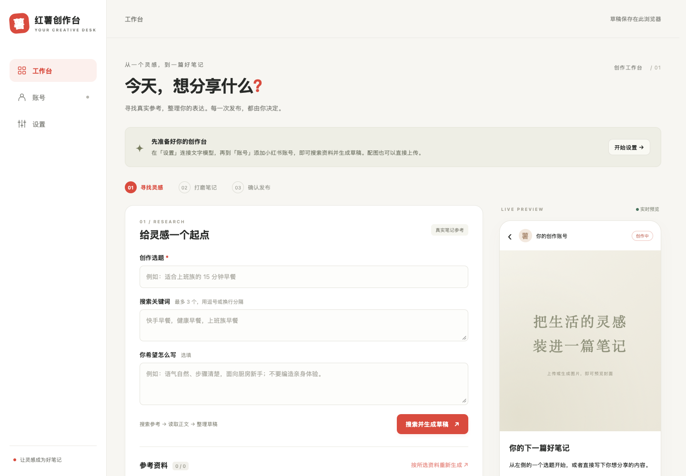
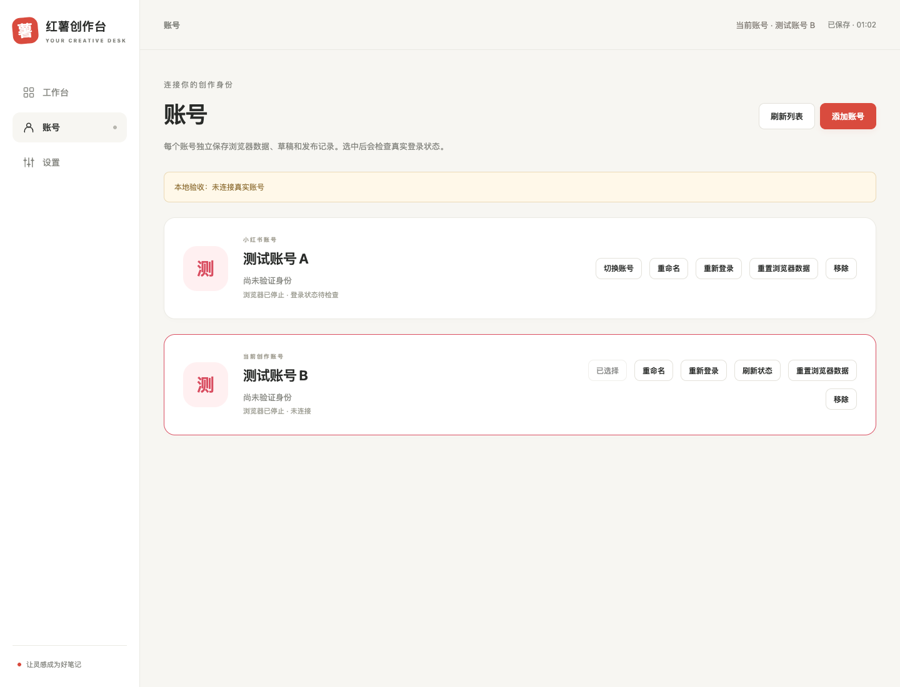

# 红薯创作台 · Xiaohongshu Studio

[English](./README_EN.md) · [桌面端](./desktop/README.md) · [Docker 部署](./docker/README.md) · [HTTP API](./docs/API.md) · [贡献指南](./CONTRIBUTING.md)

面向小红书图文创作的自部署工作台。在浏览器中完成选题搜索、参考整理、AI 写稿、配图和发布确认，并支持多个账号独立保存登录状态、浏览器数据和草稿。



## 主要功能

- **搜索取材**：搜索小红书笔记、读取正文，选择参考资料用于写作。
- **写稿与编辑**：连接自己的文字模型，生成并编辑标题、正文、话题和配图描述，实时预览图文效果。
- **上传与生图**：上传本地图片，或使用单独配置的图片模型生成配图。
- **多账号管理**：添加、重命名、切换账号；每个账号使用独立的浏览器环境，保存完整站点数据。
- **确认发布**：预览后再次确认发布；按账号保存发布保护状态，并协调同账号多个标签页的发布操作。
- **HTTP API**：通过接口使用账号管理、搜索、图文与视频发布、评论、点赞、收藏及用户资料等能力。

## 快速开始

### Docker 部署（推荐）

安装并启动 Docker，然后运行：

```bash
docker run -d \
  --name xiaohongshu-studio \
  --restart unless-stopped \
  --stop-timeout 60 \
  --shm-size=1g \
  -p 127.0.0.1:18060:18060 \
  -v "$PWD/xiaohongshu-studio-data:/app/data" \
  -v "$PWD/xiaohongshu-studio-data/uploads:/tmp/xiaohongshu_images" \
  ghcr.io/yukuiii/xiaohongshu-studio:latest
```

打开 **http://127.0.0.1:18060/**。数据保存在当前目录的 `xiaohongshu-studio-data/`；固定版本时把 `:latest` 换成 `:v0.1.0`。访问令牌、代理、素材目录等配置见 [Docker 文档](./docker/README.md)。

镜像包含工作台、Chromium 和 noVNC 登录桌面，宿主机无需安装 Go、Node.js 或浏览器。当前镜像为 `linux/amd64`，Apple Silicon 需要 Docker 的 amd64 模拟支持。

源码运行与开发见 [贡献指南](./CONTRIBUTING.md)。

## 首次使用

1. **配置模型**：进入「设置」，填写文字模型的接口地址、API Key 和模型名称。支持 OpenAI 兼容接口，可读取模型列表或手动填写名称。
2. **连接账号**：进入「账号」，添加或选择账号，打开登录网页，使用小红书 App 扫码并完成手机确认及页面要求的安全验证。
3. **寻找灵感**：回到「工作台」，在第一个 Tab 填写选题和关键词，搜索并挑选参考笔记。搜索完成后点击「下一步」进入文案步骤。
4. **撰写文案**：填写写作要求，按所选参考生成文案，或直接手写。编辑标题、正文和话题，右侧预览会同步更新。
5. **制作配图**：进入配图 Tab，上传图片或使用图片模型生成配图，检查封面和其他图片。
6. **确认发布**：进入最后一个 Tab，核对当前账号、内容和可见范围，在发布窗口中确认后提交。

可以通过 Tab 随时返回修改，切换步骤会保留已填写的内容。桌面端右侧持续显示预览，窄屏下预览排列在操作区下方。

模型接口地址需要包含服务商要求的版本路径，例如 `https://api.openai.com/v1`，程序不会自动补 `/v1`。文字和图片可以使用不同服务；生图服务需支持 OpenAI 兼容的 `images/generations` 接口，上传图片无需配置生图服务。选中的参考资料会发送给你配置的文字模型。

当前工作台主要面向图文笔记：标题最多 20 字（英文和数字按半字计），正文最多 1000 字，支持 1–9 张 JPEG、PNG、WebP 或 GIF 图片，每张不超过 10 MiB。视频发布等其他能力见 [HTTP API](./docs/API.md)。

## 多账号与登录

每个账号独立保存 Chromium 的完整用户数据，包括 Cookie、localStorage、IndexedDB、Service Worker、缓存和站点配置，并使用固定的指纹 seed 和独立下载目录。浏览器按需启动，任务之间复用；无头浏览器空闲 10 分钟后关闭，数据继续保留。

账号选择只影响当前页面，任务执行期间禁止切换。同一账号的浏览器任务串行执行，不同账号可以独立运行。

账号列表展示最近检查的“已登录 / 未登录”，刷新页面和切换账号或页面不会自动访问小红书。服务启动后异步检查一轮，之后每 10 分钟巡检；巡检通过账号会话的 Cookie/UA 发起 HTTP 请求核验，不渲染页面，忙碌或登录中的账号留待下一轮；网络错误或超时保留上次结果。巡检结束会关闭使用的空闲浏览器，保存的数据继续保留。状态和检查时间保存在服务端 SQLite 数据库中，重启后恢复；新账号显示“未登录”，尚无检查记录的已绑定账号显示“登录状态待检查”。

账号页可见时每 60 秒静默刷新列表。登录成功、清除 Cookie 或重置浏览器数据会立即更新缓存；需要立即检查时点击「刷新状态」。搜索、发布等任务仍会核验真实登录身份。

已登录账号不显示「重新登录」；已绑定账号须在检查确认失效后才显示该入口。新账号仍可首次登录，未结束的扫码窗口可继续连接。同一活动会话会被复用，陈旧页面对已登录账号的再次开启请求也不会创建新的候选 profile。

Docker 中点击登录会打开接近全屏的 noVNC 弹窗，展示真实小红书页面；二维码较小时可切换「原始大小」，查看后可切回「适应窗口」。关闭弹窗仅收起画面，后台会话保留，可点击「继续登录」重新连接。登录浏览器在桌面中以全屏方式运行，同一时间供一个账号使用。登录信息保存成功后弹窗自动关闭；未完成的登录会话最多保留 20 分钟，也可以点击「结束登录窗口」。

重新登录会先使用候选浏览器数据，确认真实身份与账号绑定一致并保存成功后再启用；取消、失败或扫码错号会保留原来的浏览器数据。站点会话仍可能过期，过期后需要重新登录。



## 配置与访问

直接运行镜像时用 `-e`/`-p`/`-v` 传入配置；使用 Compose 时写入 `docker/.env`。

| 配置 | 用途 | 默认值 |
| --- | --- | --- |
| `-e AUTH_TOKEN=...` | 工作台 API 访问令牌 | 未设置时不启用令牌鉴权 |
| `-p 127.0.0.1:<端口>:18060` | 映射到宿主机的端口 | `18060` |
| `-e XHS_PROXY=...` | 小红书浏览器访问代理，支持 HTTP、HTTPS、SOCKS5 | 不使用代理 |
| `-v <目录>:/app/data` | 持久化数据目录 | 当前目录的 `xiaohongshu-studio-data/` |
| `-v <目录>:/app/images:ro` | 已有图片素材目录 | 可选 |

设置 `AUTH_TOKEN` 后，在工作台「设置」中填写相同令牌；它与模型 API Key 分开配置，授权访问整个工作台及所有账号。HTTP API 见 [API 文档](./docs/API.md)。

页面发布使用 Web Locks 协调同账号的多个标签页，需要支持该功能的浏览器，并通过 **HTTPS 或 localhost / 回环地址**访问。发布保护依赖当前浏览器的站点存储。远程服务器可以通过 SSH 转发到本机：

```bash
ssh -L 18060:127.0.0.1:18060 user@server
```

随后打开 **http://127.0.0.1:18060/**。反向代理部署时，页面、API 和 `/desktop/` WebSocket 需要保持同源。

## 数据保存与备份

| 数据 | Docker 部署 | 源码运行 |
| --- | --- | --- |
| 账号、完整浏览器数据及下载文件 | `xiaohongshu-studio-data/accounts/` | `XHS_ACCOUNTS_DIR`，默认位于旧 Cookie 文件同目录的 `.xhs-accounts/` |
| 账号元数据、模型配置、草稿及发布防重记录 | `xiaohongshu-studio-data/studio.db`（SQLite） | `XHS_DB_PATH`，默认位于账号目录同级的 `studio.db` |
| 上传及生成的图片 | `xiaohongshu-studio-data/uploads/`，按账号保存 | 系统临时目录下的 `xiaohongshu_images/web/<account-id>/` |
| 工作台访问令牌 | 访问工作台的浏览器 localStorage | 同左 |

直接运行时数据在 `xiaohongshu-studio-data/`，Compose 部署在 `docker/data/`。备份前先停止服务，并保存完整的数据目录，其中包含模型密钥和登录凭据。服务运行中备份 SQLite 时使用 `VACUUM INTO`，或先停止服务再复制数据库和 WAL 文件。访问令牌仍只保存在浏览器，需要单独保留。

每个账号使用完整 Chromium profile；正常关闭浏览器和启动服务时会删除 Cache、Code Cache、GPU/Shader Cache 等可重建缓存，保留 Cookie、Local Storage、IndexedDB、Service Worker 和浏览器配置，因此清理后仍能保持登录态。

旧浏览器中的模型配置只会自动迁移到尚未初始化的服务端，成功后移除旧缓存；已有服务端配置优先。换浏览器时，填写工作台访问令牌即可读取服务器上的模型地址和名称。已保存的 API Key 不会返回浏览器，编辑时留空可保留同一接口的原密钥。

草稿中的图片引用不能替代图片文件，源码运行时需另行备份临时目录中的图片。浏览器数据恢复时应尽量保持运行环境一致，站点登录态仍可能过期。

「重置浏览器数据」清空该账号的站点数据，保留账号身份绑定、指纹、服务端草稿和素材；「移除账号」会清理该账号的浏览器数据、下载、托管图片以及服务端的草稿和发布记录。

此版本不再读取旧的 `state.json`、`account.json`、`settings.json` 和浏览器 localStorage 草稿。升级到该版本需要重新添加账号、扫码登录并配置模型。

## 常见问题

**扫码后仍未登录？** 查看真实登录页面是否还需要手机确认或账号安全验证。二维码过期时在页面内刷新。关闭登录弹窗会保留后台登录窗口，结束会话请使用「结束登录窗口」。

**模型请求失败？** 检查接口地址、版本路径、API Key 和模型名称是否匹配；生图模型需要支持对应图片接口。

**发布超时或结果未知？** 先到小红书确认笔记是否已发布，再按工作台提示处理发布保护，避免直接重复提交。

**首次启动下载失败？** 使用发布镜像时浏览器已内置；从源码运行或本地构建镜像时，内置 fingerprint-chromium 从官方 GitHub Release 下载，并校验仓库固定的 SHA256。源码运行可配置 `XHS_BROWSER_DOWNLOAD_BASE`，Docker 构建可配置 `BROWSER_DOWNLOAD_BASE`，具体格式见 [Docker 文档](./docker/README.md)。

## 来源与许可证

本项目基于 [xpzouying/xiaohongshu-mcp](https://github.com/xpzouying/xiaohongshu-mcp) 的浏览器自动化与 HTTP 功能改造，原作者版权为 **Copyright 2025 xpzouying**。项目采用 [Apache License 2.0](./LICENSE)，保留原项目署名与许可声明。
