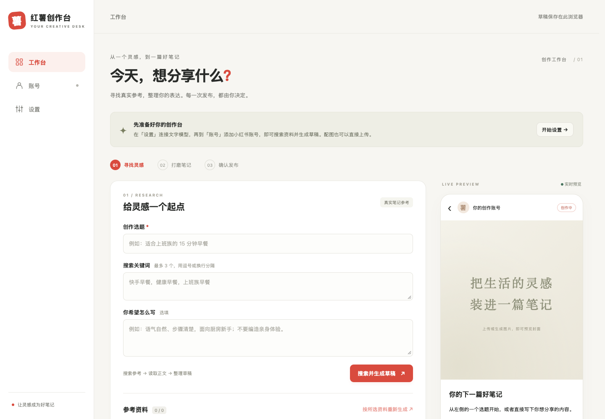
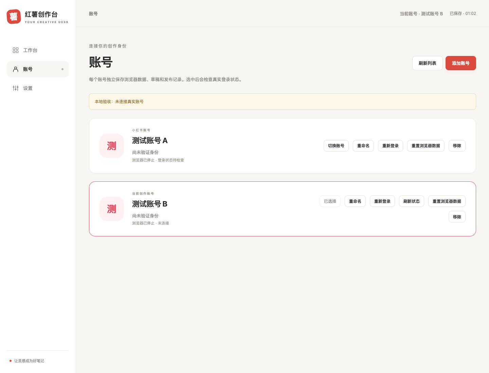

# Xiaohongshu Studio · 红薯创作台

[中文](./README.md) · [Desktop app](./desktop/README.md) · [Docker deployment](./docker/README.md) · [HTTP API](./docs/API.md) · [Contributing](./CONTRIBUTING.md)

A self-hosted workspace for creating Xiaohongshu image posts. Research topics, select references, draft with AI, add images, and confirm publication in your browser. Manage multiple accounts with separate sign-in sessions, browser data, and drafts. The application interface is in Chinese.



## Features

- **Research**: Search Xiaohongshu posts, read their content, and choose references for your draft.
- **Draft and edit**: Connect your own text model to generate titles, body text, tags, and image descriptions, then edit them with a live preview.
- **Upload and generate images**: Upload local pictures or generate illustrations through a separately configured image model.
- **Manage accounts**: Add, rename, and switch accounts. Each account has its own browser environment and persistent site data.
- **Confirm publication**: Review and confirm before creating a background publication task. Protection state is kept per account, with coordination across tabs using the same account.
- **Task history**: Open Tasks (任务) in the sidebar to view queued, running, completed, failed, and uncertain publications across accounts, including after a page reload. Published results include actions to open the note and copy its link.
- **Scheduled creation**: Set a keyword and a daily, weekly, monthly, or Cron schedule. The model chooses an angle, writes, and publishes automatically. Choose one generated image or a native long-form post, with complete content and execution history.
- **HTTP API**: Access account management, search, image and video publication, comments, likes, favorites, user profiles, and other operations programmatically.

## Quick start

### Docker deployment (recommended)

Install and start Docker, then run:

```bash
docker run -d \
  --name xiaohongshu-studio \
  --restart unless-stopped \
  --stop-timeout 60 \
  --shm-size=1g \
  -p 127.0.0.1:18060:18060 \
  -v "$PWD/xiaohongshu-studio-data:/app/data" \
  -v "$PWD/xiaohongshu-studio-data/uploads:/tmp/xiaohongshu_images" \
  ghcr.io/yukuiii/xiaohongshu-studio:latest
```

Open **http://127.0.0.1:18060/**. Data is stored in `xiaohongshu-studio-data/` in the current directory; replace the final `:latest` with `:v0.1.0` to pin a release. See the [Docker guide](./docker/README.md) for access tokens, proxies, media directories, and other configuration.

The image includes the workspace, Chromium, and the noVNC sign-in desktop; the host does not need Go, Node.js, or a browser. The image targets `linux/amd64`; Apple Silicon requires Docker's amd64 emulation support.

For running from source and development, see [CONTRIBUTING.md](./CONTRIBUTING.md).

## First use

1. **Configure a model**: Open Settings (设置) and enter the text provider's base URL, API key, and model name. OpenAI-compatible APIs are supported; fetch the model list or enter a name manually.
2. **Connect an account**: If no account exists, choose Add account (添加账号) in Workspace to open Accounts (账号), then add an account and open its sign-in page. Scan with the Xiaohongshu app and complete phone confirmation and any security checks shown on the page. Existing accounts can be selected directly.
3. **Find inspiration**: Return to Workspace (工作台). In the first tab, enter a topic and keywords, search, and select reference posts. Choose Next (下一步) when ready to write.
4. **Write**: Add writing instructions and generate from the selected references, or write manually. Edit the title, body, and tags while checking the live preview.
5. **Add images**: Open the images tab to upload pictures or generate them with an image model. Check the cover and other images in the preview.
6. **Confirm publication**: Open the final tab, verify the selected account, content, and visibility, then confirm to create a background task. Open Tasks (任务) in the sidebar for progress and results. You can continue editing or switch accounts after submission.

Use the tabs to return to earlier steps without losing your work. The preview stays on the right on desktop and appears below the controls on narrow screens.

Each account accepts one unfinished publication task at a time; different accounts run independently. Tasks retain the submitted content snapshot, so later draft edits do not change them. Records are saved in server-side SQLite. Queued tasks resume on restart; records still marked as running become uncertain and are never automatically resubmitted.

Routine reads such as task lists, account lists, and model settings do not show loading toasts. Active operations use upper-right toasts for progress and results; result toasts dismiss after about two seconds and have no close button.

Select controls use consistent light menus, with arrow-key navigation, Enter to confirm, and Escape to cancel. Menus stay within the viewport on narrow screens.

The provider URL must include any required version path, such as `https://api.openai.com/v1`; the application does not append `/v1`. Text and image models can use different providers. Image generation requires an OpenAI-compatible `images/generations` endpoint; uploading images does not require an image model. Selected reference material is sent to your configured text provider.

The workspace currently focuses on image posts: titles allow 20 counted characters, with English letters and digits counting as half; bodies allow 1,000 characters. Posts use 1–9 JPEG, PNG, WebP, or GIF images, up to 10 MiB each. See the [HTTP API](./docs/API.md) for video publication and other operations.

## Scheduled creation and publication

Open Scheduled tasks (定时任务), choose an account, and enter a creation keyword. Optionally add writing instructions for the audience, tone, style, or content preferences; leave them blank for free-form creation. Select daily, weekly, monthly, or a five-field Cron expression with an explicit time zone. Each run sends the keyword, instructions, and the titles and bodies of the account's five most recent successful publications to the text model. The model chooses a specific topic within those requirements, avoids previously covered questions and conclusions, and lets the content determine its structure without searching or reading external reference articles. Existing keyword-based schedules receive empty instructions on upgrade and retain their execution rules and history.

Recent publications include manual and scheduled posts for the currently bound identity; failed posts and other accounts are excluded. History is context for avoiding repetition, not a verified factual source. Each historical title is limited to 80 Unicode characters and each body to 1,200; longer bodies retain their beginning and ending and are marked as excerpts. Avoiding repetition depends on the model's judgment and is not guaranteed. Explicit topic and structure requirements still take priority.

Image posts are the default and generate one picture with the saved image model. Long-form posts use Xiaohongshu's native article editor, which lays out the full text as cards without an image-model call. Titles allow 20 counted characters; image posts allow 1,000 characters including tags, while long-form bodies allow 10,000. Enabled schedules publish automatically without review for each run and do not overwrite manual workspace drafts.

The list shows upcoming execution, the latest result, and model configuration errors. After fixing a missing image model, retry the latest failed or skipped run from the list. A retry uses the current configuration, retains the previous record, and leaves the normal schedule and enabled state unchanged. Repeated requests for the same retry return the same run. Successful or uncertain publications cannot be retried directly.

Run details retain the title, complete body, tags, generated image, configuration snapshot, and errors; references from older runs remain available. Keep the service running; missed times while offline are skipped, and startup resumes with the next scheduled time. Monthly dates absent from a month are skipped. If the account or schedule already has an active run, that occurrence is recorded as skipped. Accepted publications retain the existing background-task and duplicate-prevention guarantees.

After publication, the service captures the note ID from that creation request and obtains the required access parameters from the account profile by ID, then saves the complete URL. Open the note or copy its link from Tasks or scheduled run details. If publication is confirmed but the link is unavailable, the result explains why while remaining successful; a missing link never triggers republication. Older results without saved links are not backfilled.

Maintain model prompts as Markdown in [`prompt/`](./prompt/) using `{{variable}}` placeholders. Templates are embedded at build time; rebuild after editing them. See the [prompt maintenance guide](./CONTRIBUTING.md#提示词维护--prompt-templates).


## Accounts and sign-in

Each account saves a complete Chromium user-data directory, including Cookies, localStorage, IndexedDB, Service Workers, cache, and site configuration. It also has a fixed fingerprint seed and a separate download directory. Browsers start on demand and are reused between tasks. Idle headless browsers close after 10 minutes while retaining their data.

Account selection belongs to the current page, and switching is blocked during a task. Browser tasks run serially within an account; different accounts can run independently.

The account list displays the last checked sign-in status or a security-verification requirement. Reloading the page or switching accounts or views does not automatically visit Xiaohongshu. The service checks accounts asynchronously at startup and every 10 minutes. Each check uses the account session Cookie/UA to verify identity over HTTP without rendering the page, skipping busy accounts and active sign-in sessions until the next round. Network errors and timeouts preserve the previous result. A security challenge is stored separately while preserving existing sign-in data; the account card keeps a visible explanation and a Security verification (安全验证) action. Each background check closes the idle browser it used while retaining its data. Status and check time are saved in the server SQLite database and survive restarts. New accounts show as signed out; previously bound accounts without a check record are shown as awaiting a check.

While visible, the Accounts view refreshes the list silently every 60 seconds. Completing sign-in, clearing Cookies, or resetting browser data updates the cache immediately. Use Refresh status (刷新状态) for an immediate check. Tasks such as search and publication still verify the real signed-in identity.

Signed-in accounts without a security challenge hide the sign-in-again action. A previously bound account offers it after a check confirms that sign-in is no longer valid. An account requiring security verification can open the verification window even while its previous sign-in cache remains valid; a successful identity check clears the warning after verification. New accounts retain their first sign-in action, and unfinished windows reconnect to the existing session. Stale requests for an ordinary signed-in account do not create another candidate profile.

In Docker, signing in opens a nearly fullscreen dialog with the real Xiaohongshu page through noVNC. Use Original size (原始大小) to view a small QR code without scaling, then choose Fit to window (适应窗口) to restore the full desktop view. Dismissing the dialog keeps the session running; use Continue sign-in (继续登录) to reconnect. The browser runs fullscreen on the shared desktop, which serves one account at a time. The dialog closes automatically after sign-in is saved. Incomplete sessions remain available for up to 20 minutes, or you can use End sign-in window (结束登录窗口).

The native desktop app opens its bundled Chromium in a local window. Opening or ending a sign-in window continues when the app goes into the background; progress polling pauses until the app becomes visible again.

Signing in again uses a candidate browser profile. The application activates it after verifying that the real identity matches the account binding and saving the browser data. Cancelling, failing, or scanning with the wrong account preserves the previous profile. Site sessions can still expire and require another sign-in.



## Configuration and access

When running the image directly, pass these with `-e`/`-p`/`-v`; with Compose, set them in `docker/.env`.

| Option | Purpose | Default |
| --- | --- | --- |
| `-e AUTH_TOKEN=...` | Service API access token | Token authentication disabled when unset |
| `-p 127.0.0.1:<port>:18060` | Port mapped to the host | `18060` |
| `-e XHS_PROXY=...` | Proxy for the Xiaohongshu browser; supports HTTP, HTTPS, and SOCKS5 | No proxy |
| `-v <dir>:/app/data` | Persistent data directory | `xiaohongshu-studio-data/` in the current directory |
| `-v <dir>:/app/images:ro` | Existing media directory | Optional |

When `AUTH_TOKEN` is set, enter the same token in Settings. It is separate from model API keys and grants access to the entire workspace and all accounts. See the [HTTP API](./docs/API.md) for API usage.

Publication uses Web Locks to coordinate tabs for the same account. Use a supporting browser over **HTTPS or localhost / a loopback address**. Publication protection records are stored on the server and shared across browsers. For a remote server, forward the service to your computer through SSH:

```bash
ssh -L 18060:127.0.0.1:18060 user@server
```

Then open **http://127.0.0.1:18060/**. When using a reverse proxy, keep the page, API, and `/desktop/` WebSocket under the same origin.

## Storage and backups

| Data | Docker deployment | Running from source |
| --- | --- | --- |
| Accounts, complete browser profiles, and downloads | `xiaohongshu-studio-data/accounts/` | `data/accounts/` |
| Account metadata, model settings, drafts, publication protection, task history, and scheduled runs | `xiaohongshu-studio-data/studio.db` (SQLite) | `data/studio.db` |
| Uploaded and generated images | `xiaohongshu-studio-data/uploads/`, separated by account | `data/uploads/`, separated by account |
| Service access token | The visiting browser's localStorage | Same |

Direct image runs store data in `xiaohongshu-studio-data/`; Compose uses `docker/data/`, and source runs use `data/` under the current working directory. Stop the service before backing up the entire data directory, which includes model keys and sign-in credentials. To back up SQLite while the service is running, use `VACUUM INTO`; otherwise stop the service and copy the database and WAL files. The access token remains browser-only and must be retained separately.

Each account keeps a complete Chromium profile. When a browser closes normally and when the service starts, rebuildable caches such as Cache, Code Cache, and GPU/Shader caches are removed. Cookies, Local Storage, IndexedDB, Service Worker data, and browser preferences are retained, so the sign-in state survives pruning.

Legacy browser model settings migrate automatically only when the server has not been initialized; the old cache is removed after success. Existing server settings take precedence. On another browser, enter the service access token to load the saved provider URLs and model names. Saved API keys are not returned to the browser; leave the key field empty to keep the existing key for the same provider URL.

Image references in drafts do not replace the image files; include `uploads/` in your backup. Restore browser profiles in the same runtime environment where possible; site sessions can still expire.

Reset browser data (重置浏览器数据) clears an account's site data while retaining its identity binding, fingerprint, server-side drafts, and images. Remove account (移除) deletes its browser data, downloads, managed images, drafts, and publication protection while retaining task history. Accounts with unfinished publication tasks cannot be reset or removed.

Source runs do not automatically migrate the old `.xhs-accounts/`, root-level `studio.db`, or temporary images; existing files are retained. Docker and desktop data paths stay the same. A new database starts without a default account and does not import legacy JSON, Cookie files, or browser localStorage drafts. Add accounts, sign in, and configure models when starting with a new database.

## Troubleshooting

**Sign-in remains incomplete after scanning:** Check the actual sign-in page for phone confirmation or security verification. Refresh an expired QR code in the page. Dismissing the dialog keeps the browser running; use End sign-in window (结束登录窗口) to end the session.

**Model requests fail:** Check the base URL, version path, API key, and model name. The image model must support the image endpoint.

**Publication times out or has an unknown result:** Check Tasks first. Do not resubmit queued or running tasks. For an uncertain result, check Xiaohongshu before following the workspace's publication protection prompts to avoid duplicates.

**The first browser download fails:** Published images already include the browser. For source launches, configure `XHS_BROWSER_DOWNLOAD_BASE`; for local image builds, edit the download URL in the Compose configuration. See the [Docker guide](./docker/README.md).

## Origin and license

This project builds on the browser automation and HTTP functionality of [xpzouying/xiaohongshu-mcp](https://github.com/xpzouying/xiaohongshu-mcp). Original attribution is **Copyright 2025 xpzouying**. The project uses the [Apache License 2.0](./LICENSE) and retains the original attribution and license notices.
