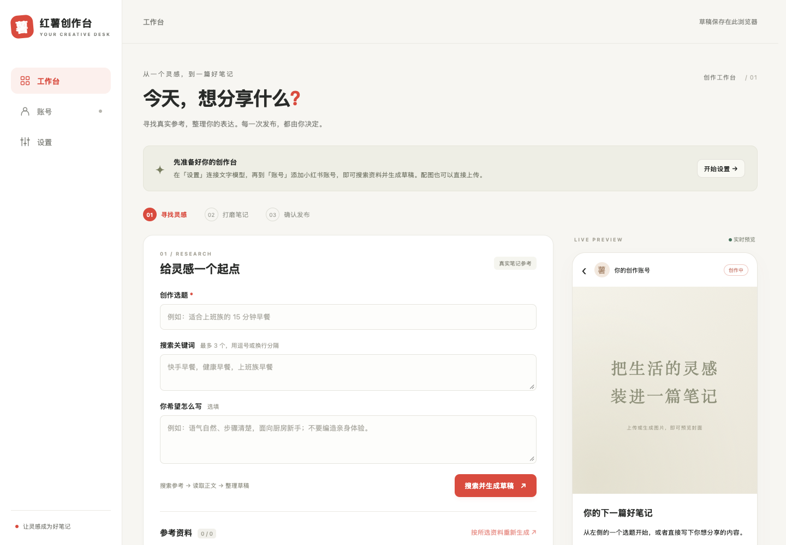
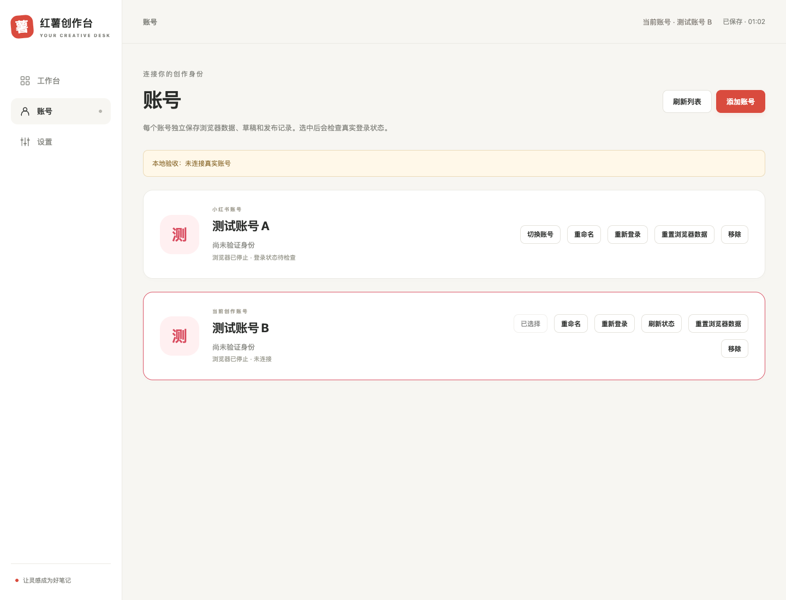

# Xiaohongshu Studio · 红薯创作台

[中文](./README.md) · [Docker deployment](./docker/README.md) · [HTTP API](./docs/API.md) · [Contributing](./CONTRIBUTING.md)

A self-hosted workspace for creating Xiaohongshu image posts. Research topics, select references, draft with AI, add images, and confirm publication in your browser. Manage multiple accounts with separate sign-in sessions, browser data, and drafts. The application interface is in Chinese.



## Features

- **Research**: Search Xiaohongshu posts, read their content, and choose references for your draft.
- **Draft and edit**: Connect your own text model to generate titles, body text, tags, and image descriptions, then edit them with a live preview.
- **Upload and generate images**: Upload local pictures or generate illustrations through a separately configured image model.
- **Manage accounts**: Add, rename, and switch accounts. Each account has its own browser environment and persistent site data.
- **Confirm publication**: Review the preview and confirm before submitting. Publication protection state is kept per account, with coordination across tabs using the same account.
- **HTTP API**: Access account management, search, image and video publication, comments, likes, favorites, user profiles, and other operations programmatically.

## Quick start

### Docker deployment (recommended)

Install and start Docker with Docker Compose available, then run:

```bash
git clone https://github.com/Yukuiii/xiaohongshu-studio.git
cd xiaohongshu-studio/docker
./up.sh
```

Open **http://127.0.0.1:18060/** once the service starts.

A single container includes the workspace, Go service, Chromium, and the noVNC sign-in desktop. The host does not need Go, Node.js, or a browser installation for the service. The first build downloads dependencies and Chromium, so build time depends on your network.

`up.sh` builds from the current source and tags the image with the current commit's 12-character SHA. Uncommitted changes to tracked files add a `-dirty` suffix. For example:

```text
ghcr.io/yukuiii/xiaohongshu-studio:15156310500a
```

The container image currently targets `linux/amd64`; Apple Silicon requires Docker's amd64 emulation support. See the [Docker guide](./docker/README.md) for data directories, proxies, download mirrors, and remote deployment.

### Run from source

Install **Go 1.27.4** and **Node.js 24**. The bundled browser supports macOS ARM64, Linux AMD64, and Windows AMD64. Native sign-in on Linux also needs Chromium runtime dependencies and a desktop environment. Run these commands from the project root:

```bash
npm --prefix web ci
npm --prefix web run build
go run .
```

Open **http://127.0.0.1:18060/**. The first launch downloads the bundled Chromium browser. On macOS and Windows, sign-in opens a local window on the computer running the service. Use Docker to operate the sign-in browser inside the workspace.

To build an executable:

```bash
go build -o xiaohongshu-studio .
./xiaohongshu-studio
```

Go embeds `web/dist/`, so build the frontend before compiling the backend. The resulting executable does not need Node.js at runtime. See the [Windows setup guide](./docs/windows_guide.md) for platform-specific commands and prerequisites.

## First use

1. **Configure a model**: Open Settings (设置) and enter the text provider's base URL, API key, and model name. OpenAI-compatible APIs are supported; fetch the model list or enter a name manually.
2. **Connect an account**: Open Accounts (账号), add or select an account, and open its sign-in page. Scan with the Xiaohongshu app and complete phone confirmation and any security checks shown on the page.
3. **Find inspiration**: Return to Workspace (工作台). In the first tab, enter a topic and keywords, search, and select reference posts. Choose Next (下一步) when ready to write.
4. **Write**: Add writing instructions and generate from the selected references, or write manually. Edit the title, body, and tags while checking the live preview.
5. **Add images**: Open the images tab to upload pictures or generate them with an image model. Check the cover and other images in the preview.
6. **Confirm publication**: Open the final tab, verify the selected account, content, and visibility, then confirm in the publication dialog.

Use the tabs to return to earlier steps without losing your work. The preview stays on the right on desktop and appears below the controls on narrow screens.

The provider URL must include any required version path, such as `https://api.openai.com/v1`; the application does not append `/v1`. Text and image models can use different providers. Image generation requires an OpenAI-compatible `images/generations` endpoint; uploading images does not require an image model. Selected reference material is sent to your configured text provider.

The workspace currently focuses on image posts: titles allow 20 counted characters, with English letters and digits counting as half; bodies allow 1,000 characters. Posts use 1–9 JPEG, PNG, WebP, or GIF images, up to 10 MiB each. See the [HTTP API](./docs/API.md) for video publication and other operations.

## Accounts and sign-in

Each account saves a complete Chromium user-data directory, including Cookies, localStorage, IndexedDB, Service Workers, cache, and site configuration. It also has a fixed fingerprint seed and a separate download directory. Browsers start on demand and are reused between tasks. Idle headless browsers close after 10 minutes while retaining their data.

Account selection belongs to the current page, and switching is blocked during a task. Browser tasks run serially within an account; different accounts can run independently.

The account list displays the last checked sign-in status. Reloading the page or switching accounts or views does not automatically visit Xiaohongshu. The service checks accounts asynchronously at startup and every 10 minutes. Each check uses the account session Cookie/UA to verify identity over HTTP without rendering the page, skipping busy accounts and active sign-in sessions until the next round. Network errors and timeouts preserve the previous result. Each background check closes the idle browser it used while retaining its data. Status and check time are saved in the server SQLite database and survive restarts. New accounts show as signed out; previously bound accounts without a check record are shown as awaiting a check.

While visible, the Accounts view refreshes the list silently every 60 seconds. Completing sign-in, clearing Cookies, or resetting browser data updates the cache immediately. Use Refresh status (刷新状态) for an immediate check. Tasks such as search and publication still verify the real signed-in identity.

Signed-in accounts hide the sign-in-again action. A previously bound account offers it only after a check confirms that sign-in is no longer valid. New accounts retain their first sign-in action, and unfinished windows can reconnect to the existing session. Stale requests for an already signed-in account do not create another candidate profile.

In Docker, signing in opens a nearly fullscreen dialog with the real Xiaohongshu page through noVNC. Use Original size (原始大小) to view a small QR code without scaling, then choose Fit to window (适应窗口) to restore the full desktop view. Dismissing the dialog keeps the session running; use Continue sign-in (继续登录) to reconnect. The browser runs fullscreen on the shared desktop, which serves one account at a time. The dialog closes automatically after sign-in is saved. Incomplete sessions remain available for up to 20 minutes, or you can use End sign-in window (结束登录窗口).

Signing in again uses a candidate browser profile. The application activates it after verifying that the real identity matches the account binding and saving the browser data. Cancelling, failing, or scanning with the wrong account preserves the previous profile. Site sessions can still expire and require another sign-in.



## Configuration and access

For Docker, set these variables in `docker/.env`, then run `./up.sh` again from `docker/`:

| Variable | Purpose | Default |
| --- | --- | --- |
| `AUTH_TOKEN` | Service API access token | Token authentication disabled when unset |
| `XHS_WEB_PORT` | Port mapped to the host | `18060`, bound to `127.0.0.1` |
| `XHS_PROXY` | Proxy for the Xiaohongshu browser; supports HTTP, HTTPS, and SOCKS5 | No proxy |
| `XHS_DATA_DIR` | Persistent data directory on the host | `docker/data/` |
| `XHS_MEDIA_DIR` | Read-only media directory mounted at `/app/images/` | `docker/images/` |

When `AUTH_TOKEN` is set, enter the same token in Settings. HTTP clients send `Authorization: Bearer <token>`. This token is separate from model API keys and grants access to the entire workspace and all accounts. Use `X-XHS-Account-ID` to select an account when multiple accounts exist; it can be omitted when there is exactly one active account.

Publication uses Web Locks to coordinate tabs for the same account. Use a supporting browser over **HTTPS or localhost / a loopback address**. Publication protection depends on the current browser's site storage. For a remote server, forward the service to your computer through SSH:

```bash
ssh -L 18060:127.0.0.1:18060 user@server
```

Then open **http://127.0.0.1:18060/**. When using a reverse proxy, keep the page, API, and `/desktop/` WebSocket under the same origin.

## Storage and backups

| Data | Docker deployment | Running from source |
| --- | --- | --- |
| Accounts, complete browser profiles, and downloads | `docker/data/accounts/` | `XHS_ACCOUNTS_DIR`; defaults to `.xhs-accounts/` beside the legacy Cookie file |
| Account metadata, model settings, drafts, and publication protection | `docker/data/studio.db` (SQLite) | `XHS_DB_PATH`; defaults to `studio.db` beside the accounts directory |
| Uploaded and generated images | `docker/data/uploads/`, separated by account | `xiaohongshu_images/web/<account-id>/` under the system temporary directory |
| Service access token | The visiting browser's localStorage | Same |

Docker paths above assume the default configuration. Stop the service before backing up the entire `docker/data/` directory or your custom data directory, which includes model keys and sign-in credentials. To back up SQLite while the service is running, use `VACUUM INTO`; otherwise stop the service and copy the database and WAL files. The access token remains browser-only and must be retained separately.

Each account keeps a complete Chromium profile. When a browser closes normally and when the service starts, rebuildable caches such as Cache, Code Cache, and GPU/Shader caches are removed. Cookies, Local Storage, IndexedDB, Service Worker data, and browser preferences are retained, so the sign-in state survives pruning.

Legacy browser model settings migrate automatically only when the server has not been initialized; the old cache is removed after success. Existing server settings take precedence. On another browser, enter the service access token to load the saved provider URLs and model names. Saved API keys are not returned to the browser; leave the key field empty to keep the existing key for the same provider URL.

Image references in drafts do not replace the image files. When running from source, back up the images in the temporary directory separately. Restore browser profiles in the same runtime environment where possible; site sessions can still expire.

Reset browser data (重置浏览器数据) clears an account's site data while retaining its identity binding, fingerprint, server-side drafts, and images. Remove account (移除) deletes its browser data, downloads, managed images, server-side drafts, and publication records.

This version no longer reads legacy `state.json`, `account.json`, `settings.json`, or browser localStorage drafts. Upgrading requires adding accounts, signing in again, and configuring models.

On first initialization, deployments with legacy Cookie files migrate them into the default account. Subsequent sessions use complete browser profiles. See the [Docker guide](./docker/README.md) for migration and offline sign-in maintenance.

## Local development

The backend uses Go, Gin, and go-rod; the frontend uses React 19 and Vite 8. Install dependencies and build the frontend once using the source setup commands, then run these in separate terminals:

```bash
# Terminal one: Go service
go run .
```

```bash
# Terminal two: frontend hot updates
npm --prefix web run dev
```

Open **http://127.0.0.1:5173/web/** for development. Vite proxies `/api`, `/desktop` (including WebSocket), and `/health` to the Go service on port `18060`. Rebuild `web/dist/` and restart Go to update the production page after frontend changes.

Common checks:

```bash
npm --prefix web test
npm --prefix web run build
go vet ./...
go test ./...
```

See the [contributing guide](./CONTRIBUTING.md) for more details. Releases use semantic version tags such as `vX.Y.Z`; pushing a version tag triggers Release and Docker image publication.

## Troubleshooting

**Sign-in remains incomplete after scanning:** Check the actual sign-in page for phone confirmation or security verification. Refresh an expired QR code in the page. Dismissing the dialog keeps the browser running; use End sign-in window (结束登录窗口) to end the session.

**Model requests fail:** Check the base URL, version path, API key, and model name. The image model must support the image endpoint.

**Publication times out or has an unknown result:** Check Xiaohongshu to see whether the post was published before following the workspace's publication protection prompts. Avoid submitting it again immediately.

**The first browser download fails:** The bundled fingerprint-chromium is downloaded from its official GitHub Release and verified against a SHA256 pinned in this repository. Configure `XHS_BROWSER_DOWNLOAD_BASE` for source launches or `BROWSER_DOWNLOAD_BASE` for Docker builds. See the [Docker guide](./docker/README.md) for the required mirror layout.

## Origin and license

This project builds on the browser automation and HTTP functionality of [xpzouying/xiaohongshu-mcp](https://github.com/xpzouying/xiaohongshu-mcp). Original attribution is **Copyright 2025 xpzouying**. The project uses the [Apache License 2.0](./LICENSE) and retains the original attribution and license notices.
